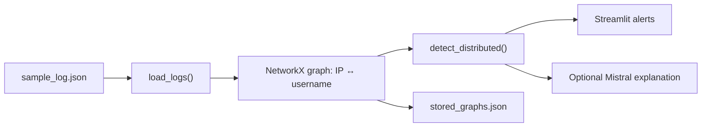

# GENDEF — Graph-Based Distributed Login Attempt Monitor

**Problem:** A login account may receive attempted access from multiple network addresses. Individual events can look ordinary; their shared account relationships may be revealing.

**Current repository scope:** A Streamlit monitoring UI reads local JSON login records, builds a NetworkX graph, checks the number of distinct IP neighbors per username, stores graph snapshots and optionally requests an explanation from a hosted language model.

> A threshold alert is a **heuristic**, not proof of a brute-force attack. The code does not establish that all observed logins were malicious.

## Explore the system visually



## Code map

| File | Function |
|---|---|
| [app.py](app.py) | Streamlit interface, URL field, threshold slider and monitoring loop |
| [detector.py](detector.py) | Log loader, graph construction, threshold-based detection, explanations, persistence |
| [sample_log.json](sample_log.json) | Example records used by the detector |
| [stored_graphs.json](stored_graphs.json) | Stored graph snapshots |
| [config.json](config.json) | Local UI configuration |
| [requirements.txt](requirements.txt) | Python dependencies |
| [alert_sms.py](alert_sms.py) | Additional alerting code requiring separate review |

## Running the local interface

Use a supported Python 3 environment:

```bash
python -m venv .venv
# activate .venv using your operating system
python -m pip install -r requirements.txt
streamlit run app.py
```

The application reads `sample_log.json` relative to the working directory and monitors it on a loop. The URL entered in the UI is persisted in `config.json`, but **the detector shown here does not fetch that URL**: do not interpret the URL input as proof of live remote monitoring.

To use the optional explanation API, supply `MISTRAL_API_KEY` securely through your process environment, never in tracked files. If credentials are missing or the remote request fails, the LLM explanation path is not expected to work.

## What the threshold means

For each username, the graph counts its neighboring distinct IP nodes. A user with at least the configured threshold produces an alert. This is a structural heuristic; it does not currently implement comprehensive rate limits, time-window semantics or confirmed malicious intent. The graph construction may merge identical names across IP/user node namespaces, so avoid treating ambiguous input schemas as validated data.

## Security precautions

- An API credential was previously embedded in source code. **Rotate/revoke it immediately**; its historic presence cannot be fixed just by changing the current file.
- Review tracked `.env`, local configuration and stored graph data before sharing.
- Treat addresses, usernames and graph outputs as potentially sensitive.
- Do not execute generated firewall rules without human review.

## Validation

For a meaningful test, load controlled synthetic logs where one username connects to fewer than and then at least the threshold of distinct IPs; verify alert counts and stored graph structure. Also check malformed JSON and API failure paths. **These tests have not been executed as part of this documentation update.**

## Status

A local prototype and analysis aid, **not** a production intrusion detection system or a verified live web monitoring service. The README explicitly distinguishes working source paths from additional integration goals.
